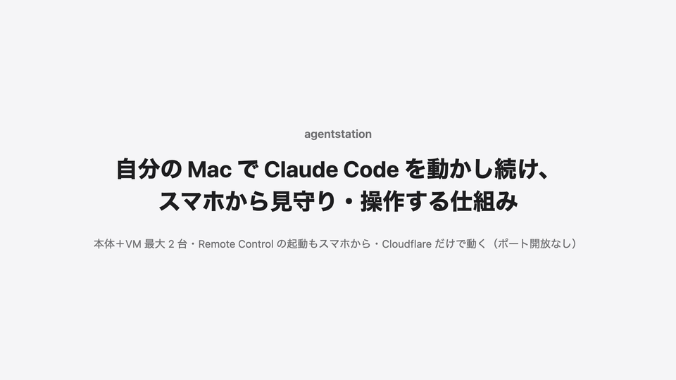
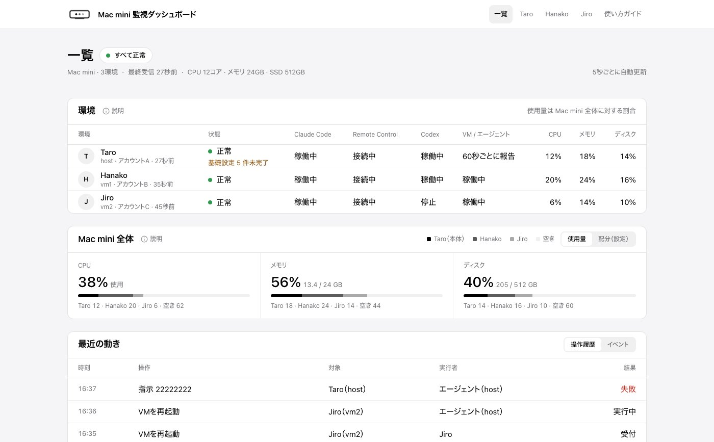

# agentstation

[English](README.md) | **日本語**

自分の Mac で Claude Code を動かし続け、スマホから見守り・操作するための仕組み。

Mac 本体と、Tart で動かす macOS の VM（0〜2 台）で、それぞれ Claude Code の Remote Control（と Codex）を常駐させる。状態は Cloudflare 上のダッシュボードで見られ、フォルダごとの Remote Control の起動も、問題が起きたときの復旧も、そこからボタンで行える。Mac は Mac mini・Mac Studio など、Claude 専用にできる Apple Silicon の Mac ならよい。

1 台の Mac を最大 3 人で分け合い、各自がスマホの Claude アプリから自分の環境の Claude Code を使う想定で作っている。1 人で本体だけを使ってもよい。

<p align="center"></p>
<p align="center"><sub>MP4 版：<a href="docs/media/overview.ja.mp4"><code>docs/media/overview.ja.mp4</code></a></sub></p>

## できること

- **Remote Control をスマホから起動**：ダッシュボードでフォルダを選ぶ（新しく作ってもよい）と、そのフォルダで Remote Control が起動し、Claude アプリで続きができる。ターミナルは使わない
- 全環境の状態を一覧で確認：Claude Code・Remote Control・Codex・VM・エージェントが動いているか、CPU / メモリ / ディスクの使用量
- ボタンで復旧：Remote Control の立て直し、Claude Code の更新、VM の再起動、ホストの再起動（猶予つき）、スマートプラグでの電源の入れ直し（SwitchBot、任意）
- フォルダごとの Remote Control の停止、前のセッションの復元、権限モードの切り替え
- 報告の途絶や再ログインが必要になったときに Slack へ通知（任意）
- ブラウザだけで SSH と画面共有（Cloudflare Access）。WARP を使えば、iPhone の SSH・VNC・ファイルアプリからも入れる
- 利用者向けの使い方ガイド（ダッシュボード内）



## 仕組み

```
スマホ・PC ──(Cloudflare Access でログイン)──> Worker ＋ D1（画面・API・1 分ごとの Cron）
                                                   ↑ 60 秒ごとのハートビートで状態を送り、指示を受け取る
Mac
 ├─ host：エージェント、claude remote-control、cloudflared（Tunnel。SSH / VNC を外向き接続で公開）
 ├─ vm1（Tart。任意）：エージェント、claude remote-control
 └─ vm2（Tart。任意）：エージェント、claude remote-control
```

- Mac からは外向きの接続しかしない。ダッシュボードで押した操作は D1 に積まれ、エージェントが次のハートビートで受け取る。ルーターのポートは開けない
- エージェントは LLM ではなく、決め打ちの操作（ホワイトリスト）だけを実行する。任意のコマンドを送る経路は無い
- パスワード・トークン・会話内容・ファイル名はダッシュボードに送らない
- 誰が何を操作できるか（オーナー／本人／閲覧者）は、Worker が Access の JWT をもとに判定する

詳しくは [`docs/spec.md`](docs/spec.md)。

## 必要なもの

- Apple Silicon の Mac。**Claude 専用にできるもの**（FileVault をオフにし、自動ログインを有効にし、スリープさせない）。VM を 2 台使うならメモリ 24GB 以上を推奨
- Cloudflare アカウントと、DNS を Cloudflare に置いた独自ドメイン（Workers・D1・Zero Trust は無料プランで足りる）
- 使う人のメールアドレス（最初はメールに届く番号でログインする。Google ログインはあとから足せる）と、Claude のアカウント
- 任意：Slack の Incoming Webhook、SwitchBot プラグミニ

## 導入

手順は Claude Code に手伝ってもらう前提で書いてある。人がやるのは、ブラウザでのログインと画面操作、sudo のパスワード入力、秘密情報の入力、実機での確認。かかる時間は半日〜1 日が目安。

```bash
mkdir -p ~/workspace && cd ~/workspace
git clone https://github.com/BridgeUI/agentstation.git
cd agentstation
claude
```

起動した Claude Code に次のように頼む（`/agentstation-install` でも同じ）。

```
kit/START.md を読んで、このリポジトリを私の環境に導入するのを手伝ってください。
```

作業の多くはスクリプトが行う。`kit/cloudflare-setup.mjs` は `kit/site.json` をもとに Cloudflare 側（Access のアプリとポリシー、サービストークン、Tunnel、DNS、D1）を作る。`kit/doctor.mjs` は、導入がどこまで済んだかを確かめて次にやることを示す。

導入先の値は `kit/site.json` だけに書き、リポジトリのファイルは書き換えない。そのため、更新は `git pull` してデプロイし直すだけで済む。

導入キットの中身は [`kit/README.md`](kit/README.md)、手順の本体は [`docs/initial-setup.md`](docs/initial-setup.md) にある。

## 制約

- 環境の名前は host・vm1・vm2 で固定。VM は 0〜2 台まで（macOS の使用許諾で、1 台の Mac で動かせる macOS の VM は 2 つまで）。VM は Tart で動かし、IP は `192.168.64.10` / `.11`
- 画面と導入手順は日本語のみ
- 実機で確かめたのは macOS 27、Claude Code 2.1 系、Tart 2.41。状態の判定は Claude Code の Remote Control のログの形などに依存しているため、バージョンが変わると判定がずれることがある（`agent/src/collect/`）

## 開発

```bash
npm ci
npm run typecheck && npm test --workspaces --if-present && npm run lint
npm run dev    # wrangler dev。ローカルの見本データは docs/dev.md
node docs/media/overview.mjs   # アニメーション（SVG）を作り直す。MP4 / GIF は docs/media/render-video.mjs
```

開発のルールは [`CLAUDE.md`](CLAUDE.md) にある。`main` には見本の値だけを入れ、実在のメールアドレス・ドメイン・Cloudflare の ID はコミットしない。

## ライセンス

[MIT](LICENSE)
