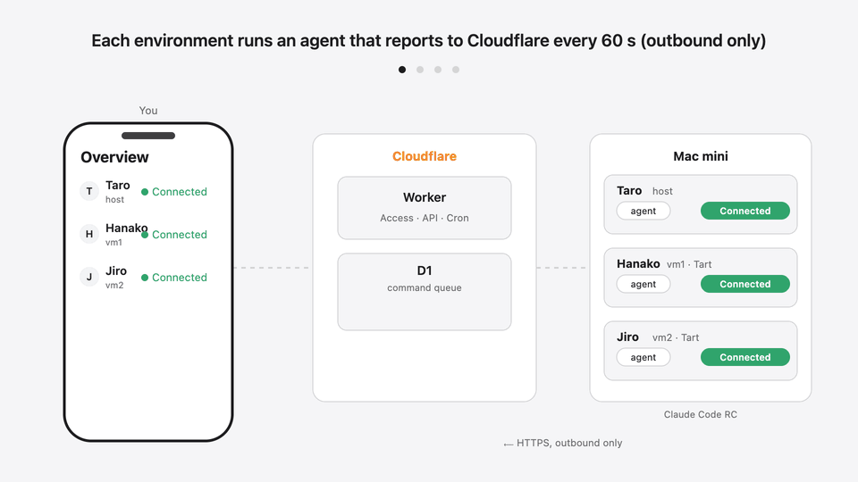

# agentstation

**English** | [日本語](README.ja.md)

Keep Claude Code running on your own Mac, and watch and control it from your phone.

The Mac itself and zero to two macOS VMs (run with [Tart](https://tart.run)) each keep Claude Code's Remote Control running, optionally alongside Codex. A dashboard on Cloudflare shows their status, and from there you can start Remote Control in any folder or fix a problem with one tap. Any Apple Silicon Mac you can dedicate to Claude works, such as a Mac mini or Mac Studio.

It is designed for up to three people sharing one Mac, each using Claude Code in their own environment from the Claude app on their phone. A single person using only the Mac itself works too.

<p align="center"></p>
<p align="center"><sub>MP4 version: <a href="docs/media/overview.en.mp4"><code>docs/media/overview.en.mp4</code></a></sub></p>

## Features

- **Start Remote Control from your phone**: pick a folder in the dashboard (or create one), and Remote Control starts there so you can continue in the Claude app. No terminal needed
- See every environment at a glance: whether Claude Code, Remote Control, Codex, the VM and the agent are running, plus CPU / memory / disk usage
- One-tap recovery: restart Remote Control, update Claude Code, restart a VM, restart the host (with a grace period), power-cycle via a smart plug (SwitchBot, optional)
- Per-folder Remote Control: stop it, restore previous sessions, choose the permission mode
- Slack notifications when reports stop arriving or a login is required (optional)
- SSH and screen sharing in the browser (Cloudflare Access). With WARP, you can also connect from SSH, VNC and Files apps on iPhone
- A built-in guide for the people using each environment


## How it works

```
Phone / PC ──(log in via Cloudflare Access)──> Worker + D1 (UI, API, 1-minute Cron)
                                                     ↑ heartbeat every 60 s: report status, receive commands
Mac
 ├─ host: agent, claude remote-control, cloudflared (Tunnel; exposes SSH / VNC over outbound connections)
 ├─ vm1 (Tart, optional): agent, claude remote-control
 └─ vm2 (Tart, optional): agent, claude remote-control
```

- The Mac only makes outbound connections. Commands from the dashboard are queued in D1 and picked up by the agent on its next heartbeat. No router ports are opened.
- The agent is not an LLM. It runs only a fixed allowlist of operations; there is no path to send arbitrary commands.
- Passwords, tokens, conversation content and file names are never sent to the dashboard.
- Authorization is decided by the Worker from the Cloudflare Access JWT (owner / member / viewer), not by hiding buttons.

Design details (Japanese): [`docs/spec.md`](docs/spec.md).

## Requirements

- An Apple Silicon Mac you can **dedicate to Claude** (FileVault off, automatic login, no sleep). 24 GB of memory or more is recommended for two VMs.
- A Cloudflare account and a domain whose DNS is on Cloudflare (Workers, D1 and Zero Trust free plans are enough)
- An email address for each person (you start with one-time codes sent by email; Google login can be added later) and a Claude account
- Optional: a Slack Incoming Webhook, a SwitchBot Plug Mini

## Installation

The setup is written to be done together with Claude Code. You handle browser logins and settings screens, sudo passwords, entering secrets, and checks on the real machine. Expect half a day to a day.

```bash
mkdir -p ~/workspace && cd ~/workspace
git clone https://github.com/BridgeUI/agentstation.git
cd agentstation
claude
```

Then ask Claude Code (or run `/agentstation-install`):

```
Read kit/START.md and help me install this repository in my environment.
```

The installation guide, the dashboard UI and most documentation are in **Japanese**. Claude Code can follow them and explain each step in English if you ask it to.

Most of the work is done by scripts. `kit/cloudflare-setup.mjs` creates the Cloudflare resources (Access apps and policies, service tokens, Tunnel, DNS, D1) from `kit/site.json`, and `kit/doctor.mjs` checks how far the setup has got and tells you what to do next.

Your settings live only in `kit/site.json`, and the repository files are never modified, so updating is just `git pull` and a redeploy.

What the kit contains: [`kit/README.md`](kit/README.md). The step-by-step procedure: [`docs/initial-setup.md`](docs/initial-setup.md).

## Limitations

- Environment names are fixed to host, vm1 and vm2. VMs: zero to two (Apple's macOS license allows up to two additional macOS instances in VMs per Mac). VMs run on Tart with IPs `192.168.64.10` / `.11`.
- The UI and installation guide are in Japanese.
- Verified with macOS 27, Claude Code 2.1.x and Tart 2.41. Status detection depends on things such as the format of Claude Code's Remote Control logs, so other versions may be misjudged (`agent/src/collect/`).

## Development

```bash
npm ci
npm run typecheck && npm test --workspaces --if-present && npm run lint
npm run dev    # wrangler dev; local sample data: docs/dev.md
node docs/media/overview.mjs   # regenerate the animation (SVG); MP4 / GIF: docs/media/render-video.mjs
```

Development rules are in [`CLAUDE.md`](CLAUDE.md). Keep only sample values on `main`; never commit real email addresses, domains or Cloudflare IDs.

## License

[MIT](LICENSE)
