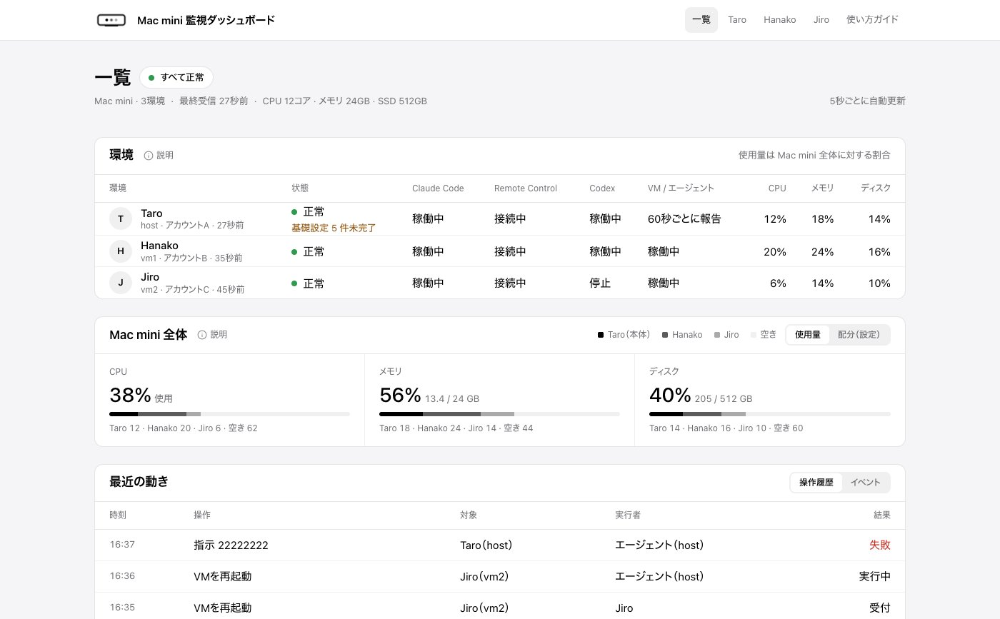

# macmini-dashboard

**English** | [日本語](README.ja.md)

Keep macOS environments running on a single Mac mini — the Mac itself plus zero to two [Tart](https://tart.run) VMs — each running Claude Code's Remote Control (and optionally Codex), and watch and operate all of them from a dashboard on Cloudflare.

It is built for up to three people sharing one Mac mini, each using Claude Code in their own environment from the Claude app on their phone. One person using only the Mac itself works too.

<p align="center"></p>

## Features

- One view of every environment: Claude Code, Remote Control, Codex, VM and agent health; CPU / memory / disk
- One-tap recovery: restart Remote Control, update Claude Code, restart a VM, restart the host (with a grace period), power-cycle via a smart plug (SwitchBot, optional)
- Per-folder Remote Control: create, start and stop; restore previous sessions
- Slack notifications for outages, login required, etc. (optional)
- SSH and screen sharing in the browser (Cloudflare Access), and over WARP from iPhone SSH / VNC / Files apps
- A built-in guide for the people using each environment



## How it works

```
Phone / PC ──(Cloudflare Access: Google login)──> Worker + D1 (UI, API, 1-minute Cron)
                                                       ↑ heartbeat every 60 s: report status, receive commands
Mac mini
 ├─ host: agent, claude remote-control, cloudflared (Tunnel; exposes SSH / VNC over outbound connections)
 ├─ vm1 (Tart, optional): agent, claude remote-control
 └─ vm2 (Tart, optional): agent, claude remote-control
```

- The Mac only makes outbound connections. Commands from the dashboard are queued in D1 and picked up by the agent on its next heartbeat. No router ports are opened.
- The agent is not an LLM. It runs only a fixed allowlist of operations; there is no path to send arbitrary commands.
- Passwords, tokens, conversation content and file names are never sent to the dashboard.
- Authorization is decided by the Worker from the Cloudflare Access JWT (owner / member / viewer), not by hiding buttons.

Design details (Japanese): [`docs/spec.md`](docs/spec.md).

## Requirements

- An Apple Silicon Mac you can **dedicate to Claude** (FileVault off, automatic login, no sleep). 24 GB of memory or more is recommended for two VMs.
- A Cloudflare account and a domain whose DNS is on Cloudflare (Workers, D1 and Zero Trust free plans are enough)
- A Google account (Gmail is fine) and a Claude account for each person
- Optional: a Slack Incoming Webhook, a SwitchBot Plug Mini

## Installation

The setup is written to be done together with Claude Code. You handle browser logins and settings screens, sudo passwords, entering secrets, and checks on the real machine. Expect half a day to a day.

```bash
mkdir -p ~/workspace && cd ~/workspace
git clone https://github.com/BridgeUI/macmini-dashboard.git
cd macmini-dashboard
claude
```

Then ask Claude Code (or run `/macmini-install`):

```
Read kit/START.md and help me install this repository in my environment.
```

The installation guide, the dashboard UI and most documentation are in **Japanese**. Claude Code can follow them and explain each step in English if you ask it to.

What the kit contains and how to take in upstream updates: [`kit/README.md`](kit/README.md). The step-by-step procedure: [`docs/initial-setup.md`](docs/initial-setup.md).

## Limitations

- Environment names are fixed to host, vm1 and vm2. VMs: zero to two (Apple's macOS license allows up to two additional macOS instances in VMs per Mac). VMs run on Tart with IPs `192.168.64.10` / `.11`.
- The UI and installation guide are in Japanese.
- Verified with macOS 27, Claude Code 2.1.x and Tart 2.41. Status detection depends on things such as the format of Claude Code's Remote Control logs, so other versions may be misjudged (`agent/src/collect/`).

## Development

```bash
npm ci
npm run typecheck && npm test --workspaces --if-present && npm run lint
npm run dev    # wrangler dev; local sample data: docs/dev.md
node docs/media/overview.mjs   # regenerate the animation above
```

Development rules are in [`CLAUDE.md`](CLAUDE.md). Keep only sample values on `main`; never commit real email addresses, domains or Cloudflare IDs.

## License

[MIT](LICENSE)
